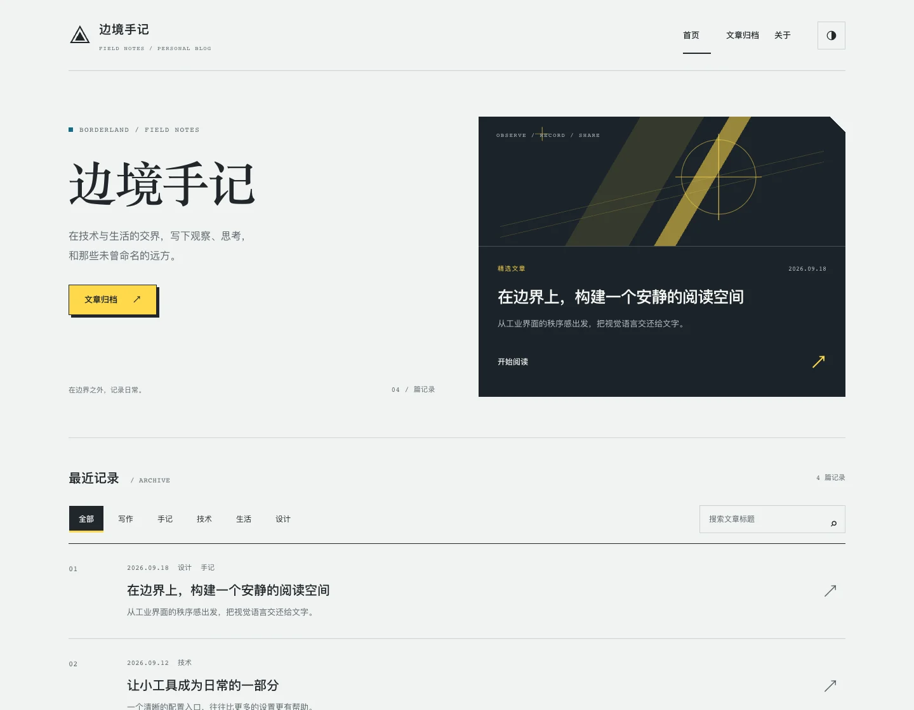
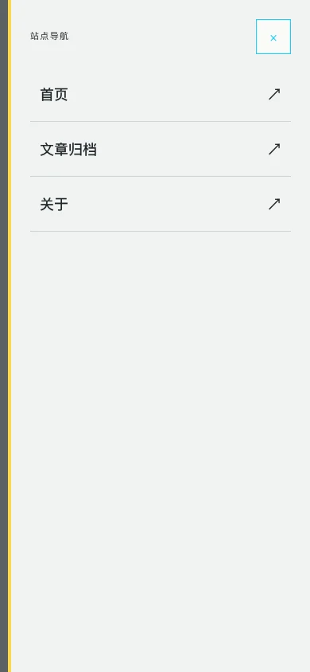

# Valaxy Theme Arknights

[Live preview](https://arknights.valaxy.site/) · [npm](https://www.npmjs.com/package/valaxy-theme-arknights) · [Publishing and deployments](https://github.com/valaxyjs/valaxy-theme-arknights/blob/main/docs/releasing.md)

An original, unofficial [Valaxy](https://valaxy.site) theme built with [AK UI](https://ak-ui.yyj.moe/) CSS Core at **system** intensity. Public semantic tokens map the theme’s palette, fonts, focus and control density. Industrial geometry and an archive-like homepage give way to a quiet reading layout.



[使用文档](docs/guide.zh-CN.md) · [User guide](docs/guide.en.md) · [Valaxy 主题文档](https://valaxy.site/zh/themes/arknights) · [AI 主题示例](https://valaxy.site/zh/themes/write#generate-a-theme-with-ai) · [AK UI Skill](https://github.com/YunYouJun/ak-ui/tree/main/skills/ak-ui)

## Try the example

Requires Node.js 22.12+ and pnpm 10. Tested with Valaxy **1.0.0-rc.11**, Vue 3, Vite 8 and AK UI **1.1.0**.

```bash
pnpm dlx degit valaxyjs/valaxy-theme-arknights valaxy-theme-arknights
cd valaxy-theme-arknights
pnpm install
pnpm dev
```

`theme/` is the source-distributed theme package. `demo/` is a separate blog that consumes it through the workspace. The published theme can also be installed into an existing Valaxy blog with `pnpm add valaxy-theme-arknights`.

## Features

- A featured entry and archive generated from Valaxy's real post metadata.
- Title search and tag filters, with combined filtering and a clear empty state.
- Article outline, code blocks, tables, images and ordinary Markdown pages.
- Persistent light/dark appearance, responsive layouts, visible keyboard focus and a skip link.
- AK UI 1.1 native dialog navigation on mobile, with focus trapping/return, Escape dismissal, reduced-motion support and a no-JavaScript fallback.
- Chinese and English interface labels selected by `siteConfig.lang`.
- Static HTML for posts and archives, with drafts excluded from production.
- Original geometric artwork and configurable site identity; no game assets.

## Make it yours

Edit `demo/site.config.ts` for your title, author and description. Write Markdown files in `demo/pages/posts/`. Set navigation and theme options in `demo/valaxy.config.ts`:

```ts
import type { ThemeConfig } from 'valaxy-theme-arknights'
import { defineValaxyConfig } from 'valaxy'

export default defineValaxyConfig<ThemeConfig>({
  theme: 'arknights',
  themeConfig: {
    eyebrow: 'PERSONAL FIELD NOTES',
    motto: 'Observe. Record. Share.',
    accent: '#ffd84a',
    outline: 'deep',
    nav: [
      { text: 'Home', link: '/' },
      { text: 'Archive', link: '/archives/' },
      { text: 'About', link: '/about/' },
    ],
    footer: 'Notes worth keeping.',
  },
})
```

| Option    | Default                   | Purpose                                                                     |
| --------- | ------------------------- | --------------------------------------------------------------------------- |
| `eyebrow` | `PERSONAL FIELD NOTES`    | Short label above the homepage title                                        |
| `motto`   | `Observe. Record. Share.` | Short sentence at the foot of the hero                                      |
| `accent`  | `#ffd84a`                 | Action and illustration color; choose a color legible with dark button text |
| `nav`     | `[]`                      | Custom internal/external links; empty uses Home and Archive                 |
| `outline` | `'deep'`                  | Valaxy heading range: a level, `[min, max]`, `'deep'`, or `false`           |
| `footer`  | `''`                      | Optional footer text                                                        |

Layouts: `home`, `post`, `default`, `404`. The theme supplies `/` and `/archives/`; user pages at the same paths override them. Posts use `title`, `description`, `date`, `tags`, `top` and `draft`. Use `description` for plain-text summaries; excerpt HTML is deliberately not injected into cards. The outline is derived from rendered headings after hydration, while article content is prerendered.

## Validate and use the package

```bash
pnpm check       # lint, SSG build, types and static-output checks
pnpm pack:theme  # artifacts/valaxy-theme-arknights-0.1.1.tgz
```

In an existing Valaxy 1.x blog, install the generated `.tgz` with `pnpm add /path/to/valaxy-theme-arknights-0.1.1.tgz`, then select `theme: 'arknights'`. The archive includes all components, pages, styles and types, and declares AK UI as a runtime dependency. No developer-checkout links are needed.

For a subdirectory deployment, build with `VITE_BASE=/your-path/ pnpm build` and set the matching `siteConfig.url`. `demo/dist` is the deployable output. A manual GitHub Pages workflow is included for this repository's `/valaxy-theme-arknights/` path; publishing or deployment is a separate author action.

Browser regression checks live in `tests/browser_smoke.py`. Start `pnpm --dir demo exec vite preview --port 4964 --strictPort`, then run:

```bash
uv run --with playwright python tests/browser_smoke.py http://localhost:4964/ /tmp/arknights-screenshots
```

The check uses headless installed Chrome and covers filters, draft exclusion, light/dark persistence, article anchors, mobile overflow, 404, keyboard navigation and reading without JavaScript. `uv` and Chrome are optional development tools, not theme dependencies.

## Build another theme with AI

Install the authoring Skills in your coding assistant, then describe your own audience, palette and layouts:

```bash
pnpm dlx skills add YunYouJun/valaxy --skill valaxy-theme
pnpm dlx skills add YunYouJun/ak-ui --skill ak-ui
```

The [Valaxy theme prompt builder](https://valaxy.site/themes/write#generate-a-theme-with-ai) includes an AK UI / Arknights brief. The [official starter](https://github.com/valaxyjs/valaxy-theme-starter) is the minimal starting point; this repository demonstrates the finished reading experience. Skill instructions assist code generation and verification, and do not require an AI API key in your blog.

## AK UI 1.1 integration

The mobile menu is a focused Vue adapter around the public `createMobileMenu` controller from `@yunyoujun/ak-ui/site`. It initializes after mounting and calls `destroy()` on disposal. Navigation links and Markdown stay in the server-rendered HTML; the menu is progressive enhancement. Its styling inherits the theme’s semantic tokens, including inside the native dialog top layer.

The reading layout intentionally keeps normal scrolling. Particle fields, asset loaders and full-page section navigation are available in AK UI but are not necessary for this blog. Nothing adds fictional loading progress or game assets.

<details>
<summary>Mobile navigation preview</summary>



</details>

## 中文说明

这是一个以 **AK UI × Valaxy** 为基础的原创主题示例。首页使用石墨色、冷白阅读面、黄色行动色和档案式文章列表；正文页保留舒适的行宽与清晰的层级。

修改 `demo/site.config.ts` 更换站点身份，修改 `demo/valaxy.config.ts` 定制导航与主题选项，在 `demo/pages/posts/` 写文章。主题与内容分离，仍然使用普通 Markdown。主题可打包安装到独立博客中；无需复制整个开发仓库。

这是独立、非官方的项目，与《明日方舟》及其权利方无关联，不包含游戏美术素材。MIT，见 [LICENSE](LICENSE)。
